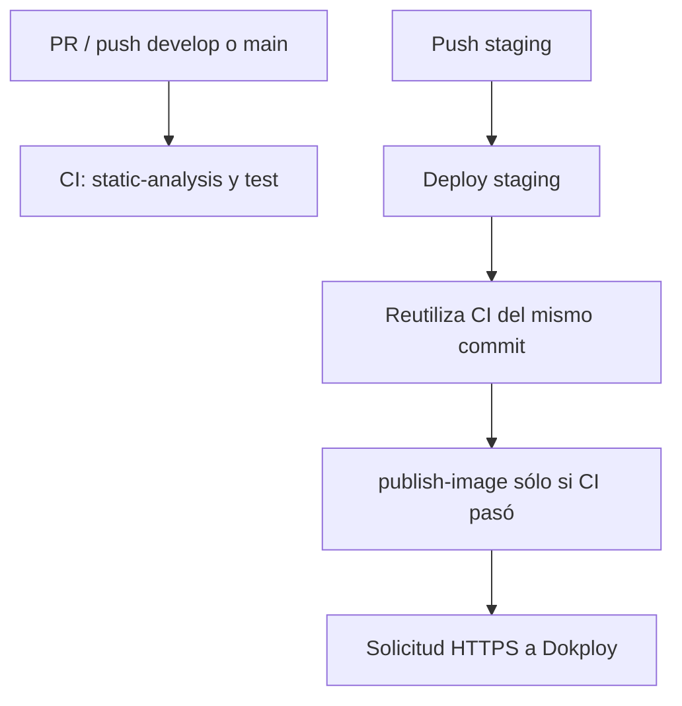

# INTEGRACIÓN CONTINUA Y CALIDAD (CI)

Este documento detalla el flujo de integración continua, las puertas de calidad automatizadas, el análisis estático y el empaquetado de artefactos del backend de Boero.

## 1. Visión General del Pipeline

Las validaciones están en [`.github/workflows/ci.yaml`](../.github/workflows/ci.yaml), visible como **CI**. Se ejecutan ante:

- **Pull Requests** hacia las ramas `develop`, `staging` y `main`.
- **Pushes** directos a `develop` y `main`.
- **Pushes a `staging`**, mediante la llamada reutilizable desde [Deploy staging](../.github/workflows/deploy-staging.yaml). No se ejecuta otro CI duplicado por ese push.

CI no publica imágenes ni recibe secrets de Dokploy. **Deploy staging** sólo se activa por push a `staging`: primero llama al mismo CI del mismo commit mediante `workflow_call`, después publica la imagen y finalmente solicita el despliegue. Así se conserva la rama `staging` para las restricciones del GitHub Environment, sin encadenar ejecuciones privilegiadas con `workflow_run`.

`develop` se ejecuta localmente: CI valida su código, pero no publica imágenes ni despliega un ambiente remoto. `main` también queda sólo con CI. No hay workflow de despliegue productivo.

Ambos workflows tienen grupos de concurrencia diferentes y cancelan ejecuciones anteriores de la misma referencia. El CI reutilizable conserva el evento, la referencia y el SHA del caller; no hace checkout del HEAD de otra rama.

## 2. Trabajos y Fases del Pipeline

Los dos archivos separan validación y despliegue sin duplicar sus validaciones:



### A. Trabajo: Análisis Estático (`static-analysis`)

Este trabajo valida la calidad del código, contratos de nulidad y detección temprana de defectos sin necesidad de levantar contenedores Docker ni bases de datos.

- **Comando**:
  ```bash
  ./gradlew --no-daemon --build-cache --continue codeStructureCheck staticAnalysis --profile
  ```
- **Toolchains de compilación**:
  - Requiere JDK 21 (compilación normal) y JDK 25 (analizador).
  - Ambos JDK se configuran automáticamente en CI mediante `actions/setup-java`.
- **Herramientas de análisis**:
  1. **NullAway (modo JSpecify estricto)**:
     - Ejecutado con `--release 21` para no alterar la versión del runtime.
     - Inspecciona el 100% de las clases de producción y pruebas (`@NullMarked`).
     - Rechaza cualquier asignación o desreferenciación potencialmente nula que no esté explícitamente declarada con `@Nullable`.
  2. **Eclipse Compiler for Java (ECJ)**:
     - Configurado en `ecj.properties`.
     - Trata cualquier advertencia como error bloqueante: imports o miembros no utilizados, conversiones inseguras (raw types), deprecaciones y fugas de recursos cerrables.
- **Artefactos**: En caso de fallo o advertencia, los informes XML de diagnóstico (`build/reports/static-analysis/`) se suben como artefactos de GitHub Actions para su inspección.

### B. Trabajo: Pruebas Automatizadas (`test`)

Garantiza que el comportamiento del sistema y los contratos HTTP e institucionales no se rompan.

- **Flujo en rama `develop` (desarrollo activo)**:
  1. **Formato**: `./gradlew spotlessCheck` (Google Java Format).
  2. **Pruebas Rápidas**: `./gradlew fastTest` (tests unitarios y slices aislados con mocks).
  3. **Detección Inteligente de Persistencia**: Un script de bash analiza el diff contra la rama base:
     - Si se modifican archivos en `src/main/resources/db/migration/`, `application*.properties`, entidades, repositorios, controladores, configuración, tests `*IntegrationTest.java` o `build.gradle`, CI ejecuta automáticamente:
       ```bash
       ./gradlew --no-daemon integrationTest
       ```
     - Si los cambios no afectan persistencia (por ejemplo, documentación o tests unitarios aislados), se omite la ejecución pesada de Testcontainers para acelerar el feedback del PR.
- **Flujo en ramas `staging` y `main` (suite completa)**:
  - Ejecuta la suite completa sin omisiones:
    ```bash
    ./gradlew --no-daemon spotlessCheck test
    ```

#### Fixtures y contratos de error

- `FlywayBranchMigrationIntegrationTest` reproduce el historial de staging hasta `20261011033241` sin las cinco migraciones de responsables/auditoría integradas después. Verifica la actualización fuera de orden sobre PostgreSQL, la conservación de personas, alumnos, vínculos e historial previo, la equivalencia de columnas con una instalación nueva y el rechazo de checksums alterados. Es un caso de regresión versionado, no una copia de los datos reales de staging ni una garantía para cualquier historial futuro.

- Las entidades creadas con fábricas de dominio no reciben un UUID hasta su persistencia. En tests unitarios que simulan entidades persistidas, usar un `spy` con `doReturn(id).when(entity).getId()` cuando el caso de uso consulta ese identificador; mantener los argumentos exactos de los mocks y la validación estricta de Mockito.
- La validación de logos distingue archivos que superan los 2 MiB (`InstitutionLogoTooLargeException`) de contenido inválido, vacío, truncado o con dimensiones excesivas (`InvalidInstitutionLogoException`). Verificar estos contratos por separado.

### C. Trabajo: Construcción y Publicación de Imágenes (`publish-image`)

Pertenece a **Deploy staging** y depende del job `ci`, que llama a las mismas validaciones de **CI**. Sólo se ejecuta por push a `staging` tras aprobar análisis estático y pruebas. El checkout y el tag `sha-<commit>` usan `github.sha`, el mismo commit validado, no el HEAD posterior de la rama.

- **Imagen Docker multi-stage**:
  - Utiliza el target `prod` de [`Dockerfile`](../Dockerfile).
  - Compila con Gradle Wrapper y extrae las capas de Spring Boot (`bootJar -Djarmode=tools extract`) para optimizar el almacenamiento en caché de Docker y acelerar despliegues posteriores.
  - El contenedor de producción corre sobre un runtime mínimo con un usuario sin privilegios (`appuser`).
- **Registro de Contenedores**:
  - Las imágenes se publican en GitHub Container Registry (`ghcr.io/typeitorg/boero-api`).
  - Se publican dos tags por imagen:
    1. Inmutable por commit: `ghcr.io/typeitorg/boero-api:sha-<commit_sha>`.
    2. Móvil de staging: `ghcr.io/typeitorg/boero-api:staging`.

### D. Trabajo: Despliegue Continuo a Staging (`deploy-staging`)

- Pertenece a **Deploy staging** y se activa tras la publicación de la imagen en pushes a `staging`.
- Usa el GitHub Environment `staging` y sus secrets `DOKPLOY_URL`, `DOKPLOY_API_KEY` y `DOKPLOY_STAGING_COMPOSE_ID` para solicitar el despliegue por HTTPS a Dokploy; no entra por SSH.
- Dokploy descarga las imágenes y ejecuta el Compose de staging de `boero-infra`, conservando los volúmenes existentes. El tag móvil `staging` identifica la última imagen publicada de esa rama; para fijar una versión se utiliza su tag `sha-<commit>` en Dokploy.
- El job confirma una solicitud asíncrona, no la salud posterior ni un rollback automático. La operación, verificación y vuelta se documentan en [Staging con Dokploy](https://github.com/TypeItOrg/boero-infra/blob/main/docs/DOKPLOY-STAGING.md).

## 3. Verificaciones de Calidad Locales Recomendadas

Antes de enviar un Pull Request, es recomendable ejecutar localmente los mismos filtros que ejecutará el CI:

```bash
# 1. Comprobar formato
./gradlew spotlessCheck

# 2. Análisis estático de tipos y nullness
./gradlew staticAnalysis

# 3. Tests rápidos
./gradlew fastTest

# 4. Tests de integración (si tocaste base de datos o migraciones)
./gradlew integrationTest
```

## 4. Rendimiento sin reducir cobertura

- Los runners se fijan en `ubuntu-24.04`; `upload-artifact` usa v7.0.2 (Node 24). El Node interno de una action no cambia el Java de la API.
- `gradle/actions/setup-gradle@v6` reemplaza la caché de `setup-java`, sin mantener dos proveedores sobre el mismo directorio. Se selecciona `cache-provider: basic`: caché de GitHub, sin servicio comercial adicional ni Build Scans publicados.
- `--build-cache` permite reutilizar compilación y otros outputs seguros. Las tareas `Test` tienen la caché de resultados desactivada: se ejecutan los tests de la suite elegida, incluidos PostgreSQL/Flyway cuando corresponden. No se modifican etiquetas, exclusiones, assertions, forks ni fixtures.
- `--profile` genera el desglose de tareas. El artifact **backend-test-reports** conserva durante 7 días los XML JUnit, el HTML de tests y los perfiles Gradle, también cuando falla la suite.
- La caché no conserva contextos Spring ni bases de Testcontainers entre jobs. Una ejecución fría puede seguir tardando más; no se promete una duración fija ni se omiten integraciones para obtener un CI verde.

### Medición local del 2026-10-20

En la misma copia aislada se comparó una ejecución completa sin build cache con otra desde `clean`, con la caché de compilación previamente poblada mediante `testClasses`:

| Ejecución | Tiempo de pared | Casos / fallos / omitidos |
| --- | --- | --- |
| Base sin caché de compilación | 163,11 s | 1008 / 0 / 0 |
| Caché de compilación caliente | 141,37 s | 1008 / 0 / 0 |

La segunda ejecución restauró `compileJava` y `compileTestJava` (`FROM-CACHE`) y ejecutó `test` realmente. Se compararon todos los identificadores y estados JUnit: mismos 1008 casos, sin omisiones. La reducción observada fue 21,74 s (13,3 %); no incluye el coste inicial de poblar la caché y no garantiza ese porcentaje en los runners de GitHub.

Las suites más lentas de la base fueron `AcademicCatalogAuditPostgresIntegrationTest` (18,47 s), `EnrollmentApplicationGuardianshipPostgresIntegrationTest` (8,49 s) y `EnversCoveragePostgresIntegrationTest` (7,08 s). Son candidatos para estudiar arranque de contextos y fixtures, no justificación para eliminar pruebas. No se cambió su aislamiento ni se habilitó paralelismo sobre bases compartidas.
